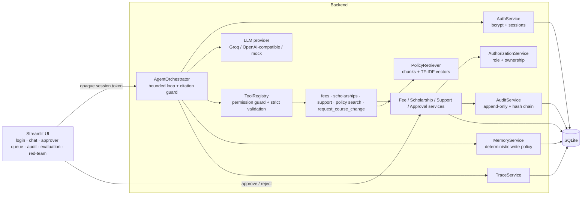
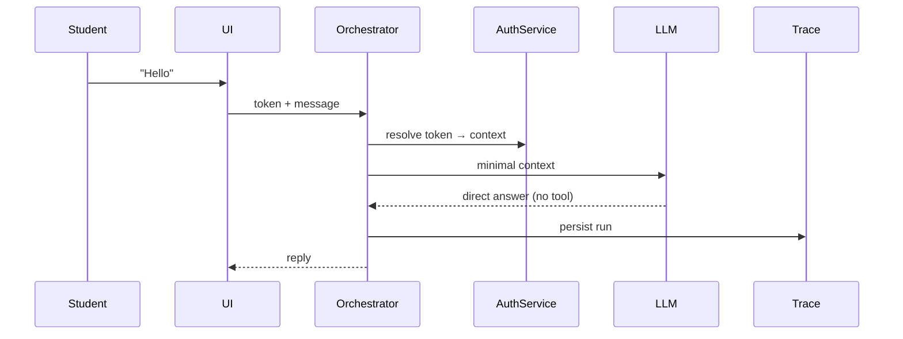
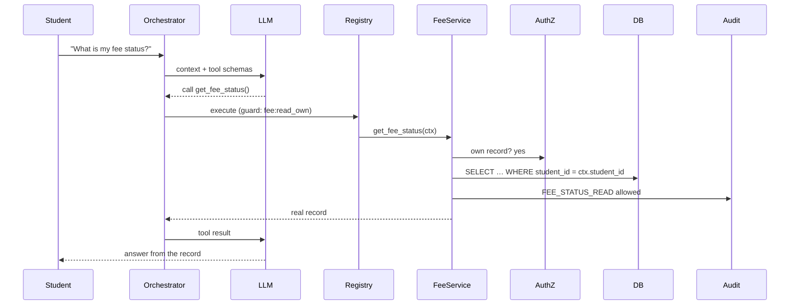
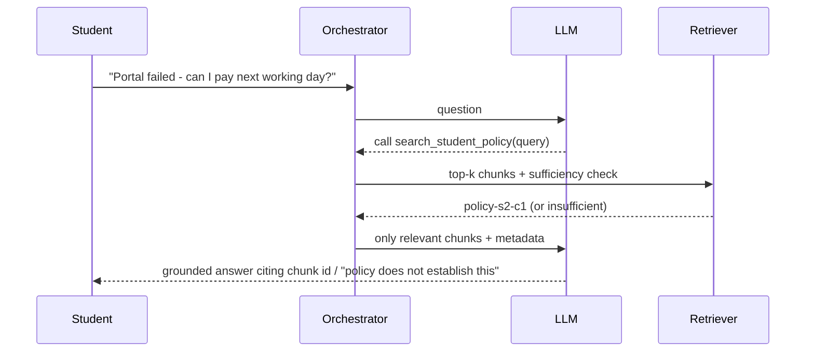
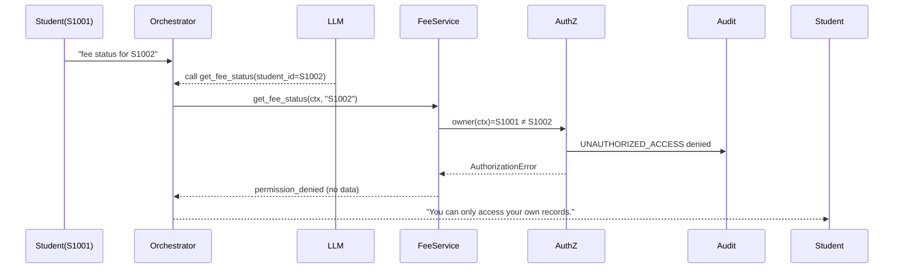

# 🎓 Student Support Agent — a safe, auditable, tool-using AI agent

One application that satisfies **Assignment 1** (Intelligent Student Support Agent) and **Assignment 2** (Safe and
Production-Aware Student Support Agent). Students chat with an agent that answers policy questions, looks up *their own* fee and
scholarship records through real tools, remembers non-sensitive preferences across sessions, and files support requests. Sensitive
changes (course changes) are **never executed by the AI**: they wait for a human approver, and everything important is audited.

> All data is **synthetic**. The policy handbook is a made-up demonstration document, not an official policy.

**Contents:** [What makes it different](#1-what-makes-this-project-different) · [Features in detail](#2-features-in-detail) ·
[Quick start](#3-quick-start) · [Using the app](#4-using-the-app-by-role) · [Architecture](#5-architecture) ·
[Database](#6-database-schema) · [Project structure](#7-project-structure) · [Testing](#8-testing) ·
[Evaluation results](#9-evaluation-results) · [Limitations](#10-known-limitations-and-security-assumptions) · [Troubleshooting](#11-troubleshooting)

---

## 1. What makes this project different

Most student-agent projects stop at "LLM + tools + a prompt that says *don't leak data*". This one is built on the opposite assumption:
**the model can never be trusted, so every rule lives in backend code and is proven by tests.**

| Standout feature | Why it matters | Where |
|---|---|---|
| 🛡️ **Compromised-model red-team lab** | A scripted *hostile LLM* proposes 15 attacks (other students' IDs, smuggled `role=admin` fields, SQL-injection strings, fake privileged tools, 10k-character payloads, tool-call floods, endless loops, role abuse, memory poisoning). All 15 are blocked, each with safe error codes and audit evidence. Two "test-the-tests" checks break a control on purpose and prove the lab notices. | `services/redteam.py`, UI page *Red-team lab*, `reports/redteam_report.md` |
| 🔗 **Tamper-evident audit trail** | Audit rows are append-only (database triggers) **and** hash-chained. If a privileged attacker drops the triggers and edits or deletes a row, the integrity check still catches it. | `services/audit.py`, UI button *Verify audit hash-chain integrity* |
| ⚖️ **Approver risk advisor** | The human approver sees a deterministic LOW/MEDIUM/HIGH advisory (no reason given, scarce seats, earlier rejected requests, near expiry) using no private data. It only advises; a human always decides. | `ApprovalService.assess_risk` |
| 📎 **Citation guard** | If the model cites a policy chunk it never retrieved, the citation is stripped and the event traced, so the agent can't fabricate evidence. | `agent/orchestrator.py` |
| 🔒 **Strict tool schemas** | Unknown or smuggled tool arguments are rejected, not ignored. | `tools/*.py` |
| 🧪 **Honest, reproducible evaluation** | Baseline numbers come from the code at git tag `milestone-1-assignment-1`; re-running that tag reproduces them. Every figure is computed from executed tests; mock results are labelled; unavailable token counts are never invented. | `services/evaluation.py`, `reports/` |
| 🎨 **Animated cat-universe UI** | The cat image becomes a slowly zooming, blurred living background with drifting aurora light, a moving grid and floating particles; glass panels, a glowing rotating-ring mascot, chat bubbles that rise in, animated chips, hover effects, responsive layout, and `prefers-reduced-motion` support. Screenshot-tested in a real headless browser on desktop and mobile. | `ui/theme.py`, `assets/` |
| 🔊 **Spoken project tour** | An in-app player reads `data/narration.md` aloud with text-to-speech: chapters, play/pause/stop, previous/next, voice and speed controls, live sentence highlighting. Available **before login** and for every role. A pre-rendered recording is included as an offline fallback. Edit the file and the tour changes everywhere. | `ui/tour.py`, `data/narration.md`, `services/narration.py` |
| 🔌 **Works without the LLM** | Quick lookups call the same authorized tools with no model at all, so students keep service if the API is down. | UI sidebar |

---

## 2. Features in detail

### 2.1 Chat agent and the agent loop (`agent/orchestrator.py`)
Each message goes through a bounded loop: **resolve identity → apply the memory write policy → build a minimal context → model proposes a
tool call → registry guard + argument validation → execute → real result goes back to the model → final answer → trace saved.**
The model *proposes*; application code *decides*. Limits: 4 steps, 4 tool calls per run, an overall deadline, per-call timeout. Failures return
friendly messages (no stack traces): LLM outage, timeout, empty response, invalid model output, tool error, loop limit.

### 2.2 Tools (`tools/`)
| Tool | Purpose | Input (validated) | Permission |
|---|---|---|---|
| `get_fee_status` | Own fee record: total, paid, outstanding, due date, status | optional `student_id` (`S####`; any other id is denied) | `fee:read_own` |
| `get_scholarship_status` | Own scholarship scheme/status/amount | same | `scholarship:read_own` |
| `create_support_request` | Create a ticket (Fees/Scholarship/Course Change/Technical/Other, priority) | category, description 10–500 chars, priority | `support:create_own` |
| `search_student_policy` | Retrieve relevant handbook chunks | query ≤300 chars, `top_k` 1–5 | `policy:read` |
| `request_course_change` | **Sensitive:** creates a *pending approval request* only | new course (code or name), optional reason | `course_change:request_own` |

All tools read the real database. All reject unknown fields. There is deliberately **no approve/execute tool** for the AI.

### 2.3 Policy retrieval (`services/policy_retrieval.py`, `data/student_policy.md`)
Markdown handbook → normalise → section/paragraph chunking with metadata (document, section, `chunk_id` such as `policy-s2-c1`) → sparse TF-IDF
vectors → cosine search with a **sufficiency decision** (minimum similarity *and* query-term coverage, plus a relative cut-off that drops weak
extra chunks). If the policy doesn't cover a question (e.g. hostel curfew), the agent says *the policy does not establish an answer* and points to the
Student Support Desk instead of guessing. Only relevant chunks reach the model, never the whole handbook.
*(TF-IDF is lexical; the retriever interface is stable so a dense/Chroma backend can be swapped in — not implemented.)*

### 2.4 Persistent memory (`services/memory.py`)
Survives sessions and restarts; stored in SQLite with timestamps; supports create, read, update, delete and inspection (UI *My memory*).
A **deterministic write policy** (regex, not the LLM) allows only four non-sensitive keys: programme, preferred language, contact preference,
preferred name. Memory is *never* used as proof of identity or permission (tested, including "memory poisoning").

### 2.5 Context selection
The model receives only: system prompt, **relevant** memory (style hints plus items related to the question), the last 6 *redacted* messages, the
redacted question, and tool results. Unrelated memory, other students' data and the whole handbook are never sent (tested).

### 2.6 Authentication (`services/authentication.py`)
Username + password with **bcrypt** hashes; generic error messages (no user enumeration); lockout after 5 failed attempts for 5 minutes; 72-byte
password limit handled; logout revokes the session; sessions expire (8 h). The browser holds an opaque random token; the server stores only its
SHA-256 and derives identity (user, role, linked student) from it on every call. A student ID typed in chat or supplied by the model is never identity.

### 2.7 Authorization (`services/authorization.py`)
Two backend layers: **role permissions** (student / approver / admin, checked by the tool guard before a tool runs) and **record ownership**
(queries are scoped to the authenticated student's own id; any other id is denied and audited as `UNAUTHORIZED_ACCESS`). Approver/admin roles have
no access to student fee or scholarship records. Tested with no LLM and no frontend.

### 2.8 Human-approval workflow (`services/approvals.py`)
*Stage 1 – request:* validate course, seats, ownership → create a `PENDING` row → **nothing changes**; one pending request per student (database-level
partial unique index). *Stage 2 – decision (approver UI):* only approver/admin, never the requester; one transaction claims the request
(`PENDING→PROCESSING`), checks expiry (72 h), then rejects, or re-validates the **current** record and executes. Never executed: pending, rejected,
expired, stale (course changed / seat gone), failed (rolled back and recorded `FAILED`), duplicate approval. A concurrent double-approval executes at most once.

### 2.9 Approver risk advisor
Each request in the queue shows a 🟢/🟠/🔴 advisory with its factors and the line *"Advisory only — the decision is always made by a human approver."*

### 2.10 Audit log (`services/audit.py`)
Persistent events with: event id, timestamp, actor id/role, action, target type/id, permission decision, approval id/decision, approver, execution status,
result, error category. Covers logins (success/failure/lockout), own-record reads, unauthorized attempts, support tickets, course-change requests,
approvals/rejections, executions, failures, LLM/tool failures and "sensitive input not stored". Details are allow-listed and redacted (no passwords, OTPs,
keys or fee amounts). Append-only via DB triggers **plus** a SHA-256 hash chain with a one-click verifier. Students cannot read it.

### 2.11 Privacy filters and redaction (`services/privacy.py`)
Detects passwords, OTPs, PINs, tokens, API keys (`gsk_…`, `sk-…`, JWTs), bearer tokens, card numbers, PAN/Aadhaar shapes. A message containing a secret stores
**nothing** in memory, is redacted before reaching the model, the trace and the audit log, and the agent reminds the student not to share credentials.

### 2.12 Citation guard
Any `policy-sX-cY` citation in an answer must match a chunk retrieved in that same run; otherwise it is replaced by `[unverified citation removed]` and the
trace records `guard:citation_removed`.

### 2.13 Tracing (`services/tracing.py`)
One row per run: run id, timestamp, session/student, redacted question, category and decision, tools with redacted arguments, authorization decision per tool,
approval state, policy chunks, memory references, context sources, end-to-end and model latency, **provider-reported** token usage (or `unavailable`),
provider/model, error category, outcome. Approvers/admins can browse traces; students see their own run details in chat.

### 2.14 Evaluation harness (`services/evaluation.py`)
Every case runs on a fresh temporary database. Metrics with explicit denominators: task success, task accuracy (ground truth), appropriate tool selection,
latency (mean/median/p95), tokens, unauthorized-access prevention, approval enforcement, rejection enforcement, unauthorized-approval blocking, stale/expired
safety, memory privacy, authentication checks, audit coverage, red-team block rate. Generates JSON + Markdown reports and the baseline-vs-final comparison.

### 2.15 Red-team lab (`services/redteam.py`)
Attack catalogue RT-01…RT-15 (see `reports/redteam_report.md`). Each attack passes only if no data leaked, no state changed, every proposed call failed with the
expected safe code, required audit events exist and the audit hash chain remained intact.

### 2.16 LLM providers (`agent/llm.py`)
`OpenAICompatibleProvider` (Groq preset, or any OpenAI-style endpoint; model name from config; timeouts and error categories; real token usage when returned)
and `MockProvider` (deterministic rule-based stand-in for offline tests — **not an LLM**, always labelled as such). A missing key gives a clear configuration error;
fake responses are never passed off as a live model.

### 2.17 Animated UI (`ui/theme.py`, `.streamlit/config.toml`)
Dark glassmorphism theme layered over the animated background you supplied (`assets/cat_bg.jpg`, a processed copy of the cat image; the circular mascot
`assets/cat_mascot.png` is the assistant's chat avatar, the sidebar logo and the login hero). Layers, back to front: slow Ken-Burns zoom/pan of the cat,
three drifting colour blobs, a moving perspective grid, 28 floating particles, a vignette. Buttons, chips and messages have motion and hover states; users who
prefer reduced motion get a still version. The login page, chat suggestions ("Try asking"), KPI tiles on staff pages, the risk badge and the audit-verification
banner are all styled. The theme is presentation only and contains no business logic.

### 2.18 Spoken project tour (`ui/tour.py`, `data/narration.md`)
The tour text lives in **`data/narration.md`** (eleven chapters, about 700 words, ~4½ minutes): welcome, the agent loop, tools, honest policy answers, memory,
identity and privacy, human approval, the verifiable audit trail, the red-team lab, honest evaluation, and what makes the project different.
* **How it speaks.** The server reads the file and passes it to a player that uses the browser's built-in text-to-speech (Web Speech API): pick a voice (neural/"natural"
  voices are ranked first), change speed, jump between chapters, and watch the current sentence highlight. No data leaves your machine.
* **Offline recording.** `assets/tour.mp3` was rendered from the same file with the local **espeak-ng** engine (a classic formant synthesiser, so it sounds robotic;
  it is included so the tour works even where the browser has no voices). Re-render or upgrade it with
  `python scripts/generate_narration_audio.py --engine espeak|pyttsx3|gtts` (`gtts` is online and the most natural-sounding).
* **Accuracy guard.** A test checks the script mentions every headline feature, is plain speakable text (no markup or digits), and that its "fifteen attacks"
  claim matches the real red-team catalogue, so the narration cannot silently drift from the project.
* **Honest note.** The speech engines are text-to-speech systems, not neural voice models bundled with the project; the sandbox that built this could not
  download neural TTS models, and the browser player could not be *heard* there (the headless browser has no voices) – its controls, chapter navigation and highlighting
  were exercised, and the audio file was produced and measured (about 275 seconds).

---

## 3. Quick start

```bash
python3 -m venv .venv && source .venv/bin/activate        # Windows: .venv\Scripts\activate
pip install -r requirements.txt
cp .env.example .env                                       # default MODEL_PROVIDER=mock (offline)
python scripts/initialize_database.py --reset              # create DB + seed (safe to re-run without --reset)
streamlit run app.py                                       # open http://localhost:8501

pytest -q                                                  # 114 tests, no network or API key needed
python scripts/run_evaluation.py --assignment 2            # final evaluation + comparison with the baseline
python scripts/run_redteam.py                              # compromised-model red-team lab
python scripts/generate_samples.py                         # sample trace + audit records
```

**Live LLM (optional):** in `.env` set `MODEL_PROVIDER=groq`, `GROQ_API_KEY=…`, `MODEL_NAME=<a tool-calling model your key can use>`; then
`python scripts/run_evaluation.py --assignment 2 --provider env --out reports/assignment_2_final_live.json` for real latency and token numbers.
Configuration keys are listed in `.env.example`.

**Demo accounts (local only; stored as bcrypt hashes):**

| Username | Password | Role |
|---|---|---|
| `aarav` | `Aarav@2026` | student S1001 (partially paid fees, approved scholarship) |
| `diya` | `Diya@2026` | student S1002 (fees paid, scholarship under review) |
| `kabir` | `Kabir@2026` | student S1003 (overdue fees, no scholarship) |
| `approver` | `Approver@2026` | approver |
| `admin` | `Admin@2026` | admin (approver rights + runs evaluations/red-team) |

---

## 4. Using the app by role

**Everyone** — the *Project tour* page (also reachable from the login screen) plays the spoken tour.

**Student** — *Chat* (policy questions, own fee/scholarship, tickets, course-change requests, preferences), *My requests* (tickets and approval status),
*My memory* (inspect/forget), *Project tour*, sidebar *Quick lookups* (no LLM needed). Each answer has an expander with tools, authorization decision, evidence, memory and latency.

**Approver / Admin** — *Approval queue* (requester, proposed change, consequences, risk advisor, notes, approve/reject, audit events for the request),
*Approval history*, *Audit log* (filter + hash-chain verification), *Traces*, *Evaluation* (baseline, final, comparison), *Red-team lab*, *Project tour*.
Hiding pages is only a convenience: the backend re-checks permissions on every call.

Instructor walkthrough: [`docs/demo_guide.md`](docs/demo_guide.md).

---

## 5. Architecture



**Agent loop:** 1 resolve identity from the session token → 2 memory write policy (secret ⇒ store nothing) → 3 minimal context → 4 model proposes tool calls →
5 role guard → strict argument validation → execute → service re-checks ownership → 6 real result back to the model → 7 answer + citation guard (max 4 steps) → 8 trace.

<details><summary><b>Sequence diagrams</b> (normal query, fee tool, policy retrieval, unauthorized access, approval, rejection)</summary>





```mermaid
sequenceDiagram  %% 5. Sensitive action approval
  Student->>Orchestrator: "change my course to Machine Learning"
  LLM-->>Orchestrator: call request_course_change
  Orchestrator->>ApprovalService: request (validate, ownership)
  ApprovalService->>DB: INSERT approval PENDING (no change)
  ApprovalService->>Audit: COURSE_CHANGE_REQUESTED
  Orchestrator-->>Student: "NOT applied; needs approval"
  Approver->>ApprovalService: decide(APPROVE)
  ApprovalService->>AuthZ: role approver? not requester?
  ApprovalService->>DB: claim PENDING→PROCESSING, revalidate, execute, EXECUTED (one transaction)
  ApprovalService->>Audit: APPROVAL_APPROVED + SENSITIVE_ACTION_EXECUTED
```
```mermaid
sequenceDiagram  %% 6. Approval rejection
  Approver->>ApprovalService: decide(REJECT)
  ApprovalService->>DB: claim, status=REJECTED (executor never called)
  ApprovalService->>Audit: APPROVAL_REJECTED (NOT_EXECUTED)
  Approver->>ApprovalService: decide(APPROVE) later
  ApprovalService->>Audit: DUPLICATE_DECISION_BLOCKED
  ApprovalService-->>Approver: already rejected; nothing executed
```
</details>

---

## 6. Database schema
SQLite via SQLAlchemy (`database/models.py`). `courses`, `students` (profile), `fee_records`, `scholarship_records`, `support_requests`, `memory_items`
(unique per student+key), `traces`, `users` (bcrypt hash, role, optional unique `student_id` — authentication kept apart from the profile), `auth_sessions`
(token hash), `approval_requests` (status machine; **partial unique index: one PENDING per student+action**), `audit_events` (**append-only triggers + hash chain**).
Foreign keys are enforced; state changes use transactions. An outdated database file is detected with instructions (`scripts/initialize_database.py --reset`).

## 7. Project structure
```
app.py                      Streamlit UI (presentation only)
ui/                         theme.py (animated background, glass theme) · tour.py (text-to-speech tour player)
assets/                     cat_bg.jpg · cat_mascot.png · tour.mp3 (pre-rendered narration)
config/settings.py          environment-based configuration
agent/                      orchestrator.py · llm.py (providers) · tool_registry.py · prompts.py · state.py
tools/                      fees · scholarships · support_requests · policy_search · sensitive_actions
services/                   authentication · authorization · approvals · audit · memory · privacy · policy_retrieval
                            records · tracing · evaluation · redteam · container
database/                   models · connection · initialization
data/                       student_policy.md · sample_students.json (synthetic) · narration.md (spoken tour script)
tests/                      114 tests (unit, integration, end-to-end, security, UI smoke, red-team)
scripts/                    initialize_database · run_evaluation · run_redteam · generate_samples
reports/                    baseline, final, comparison, red-team, sample trace/audit
docs/                       requirements_checklist · privacy_and_approval_rules · demo_guide · architecture_milestone1
```

## 8. Testing
`pytest -q` → **114 passed** (offline, isolated temp databases, deterministic). Covers: tools and argument validation, retrieval relevance/insufficiency,
memory CRUD/persistence/relevance/credential blocking, agent loop bounds, minimal context, citation guard, LLM provider HTTP handling (mocked transport), authentication
(hashing, lockout, expiry, forged tokens), authorization (service-level, no LLM), approvals (approve/reject/duplicate/expired/stale/failed/concurrent/self-approval),
audit (fields, append-only, hash chain, secrets), red-team (including mutation checks), headless Streamlit UI flows for student, approver and admin.

## 9. Evaluation results
Generated by the harness (never hand-typed); see `reports/evaluation_comparison.md`. **Provider = deterministic mock** (so tool-selection/accuracy reflect application
logic, not LLM quality; latency excludes network/LLM time; tokens are `unavailable`).

| Measure | Assignment 1 baseline | Assignment 2 final |
|---|---|---|
| Task success (same 11 cases) | 11/11 | 11/11 |
| Cross-student request | returned another student's record | blocked (10/10 attempts) |
| Sensitive actions held until approval | not built | 7/7 |
| Rejection enforcement | not built | 2/2 |
| Credential-in-chat privacy | 1/1 (simple filter) | 5/5 |
| Audit coverage + integrity checks | not built | 19/19 |
| Compromised-model attacks blocked | not tested | 15/15 |
| All Assignment-2 scenarios | n/a | 17/17 |
| Mean latency per turn | about 3.0 ms | about 4.5 ms (varies about 1 ms per run) |

Reports: `reports/assignment_1_baseline.md` (from tag `milestone-1-assignment-1`), `reports/assignment_2_final.md`, `reports/evaluation_comparison.md`,
`reports/redteam_report.md`, `reports/sample_audit_trace.md`. Requirement traceability: `docs/requirements_checklist.md`; rules: `docs/privacy_and_approval_rules.md`.

## 10. Known limitations and security assumptions
* **No live LLM call was executed during development** (the build sandbox could not reach Groq). The provider is implemented and its HTTP handling is unit-tested with a mocked
  transport; live accuracy, tool-choice quality, latency and token usage are **not measured** here.
* A small synthetic test set shows the controls behave as designed; it does **not** prove production security.
* Local demo: no TLS, MFA, SSO or password reset; demo passwords are in a seed file (demo-only).
* Audit hash chain: deleting the *newest* rows is undetectable unless the head hash is anchored externally; the in-process chain lock assumes a single server process.
* One sensitive action (course change). SQLite serialises writers (a concurrent loser may see a lock error — still safe, tested).
* TF-IDF retrieval is lexical (synonyms can be missed); secret detection is pattern-based and can miss novel formats or over-block messages that merely mention "password".
* A real deployment would also need: SSO/MFA, TLS and secure cookies, a hardened database with row-level security and WORM audit storage, rate limiting, DLP, and a security review.

## 11. Troubleshooting
* *"Database schema is outdated"* → `python scripts/initialize_database.py --reset`.
* *"LLM not configured"* → set `MODEL_PROVIDER`, `MODEL_NAME`, `GROQ_API_KEY` in `.env` (or use `mock`); quick lookups still work.
* *Account locked* → wait 5 minutes or reset the DB.
* *`ModuleNotFoundError: config`* → run commands from the project root.
