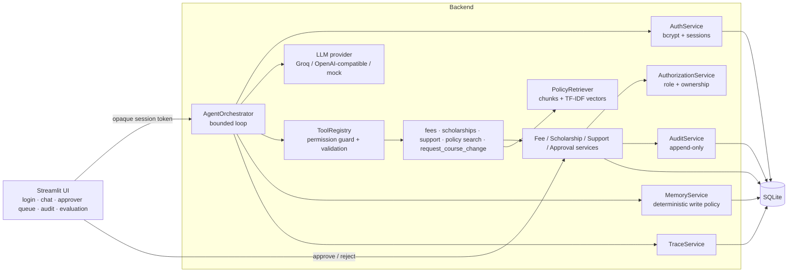
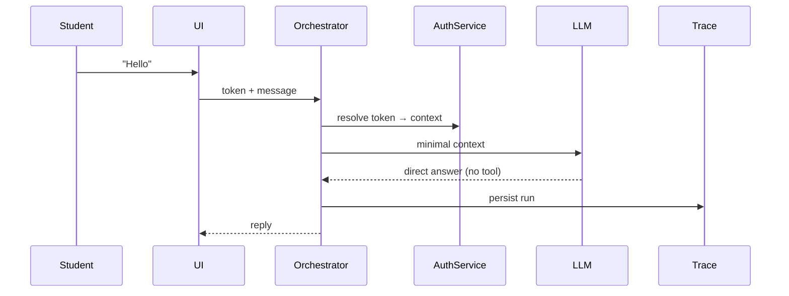
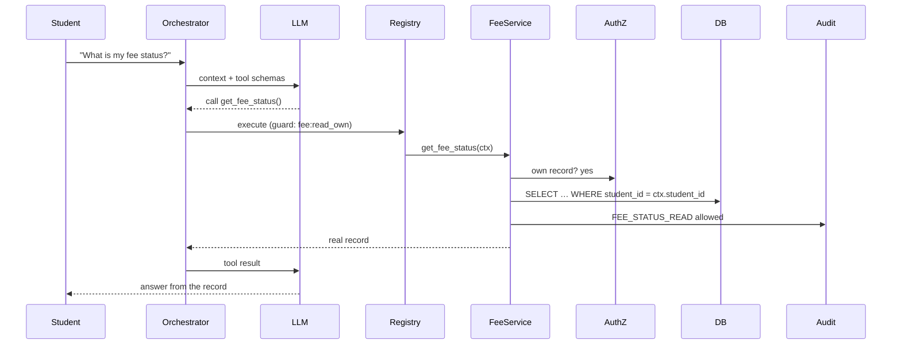
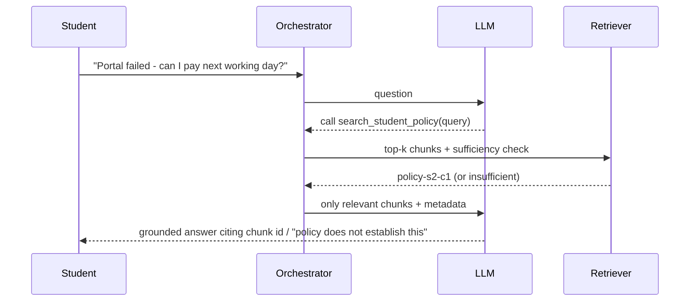
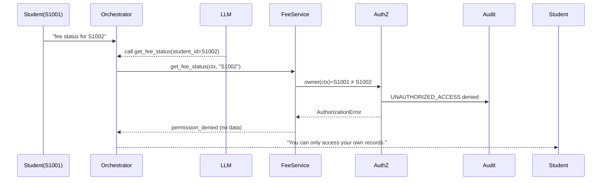

# Student Support Agent (Assignments 1 + 2)

A chat-style AI support agent for a (fictional) institute. **Assignment 1** builds the agent: a tool-using loop, persistent
memory, policy retrieval, context selection, tracing and measurement. **Assignment 2** extends the *same codebase* with
authentication, record-level authorization, human approval for sensitive actions, audit logging and memory privacy.
All data is **synthetic**.

> **Honesty notes.** (1) The sandbox this was built in could not reach Groq, so all reported numbers come from a deterministic,
> clearly labelled **mock provider** (rule-based, not an LLM). The Groq/OpenAI-compatible provider is implemented and its HTTP
> handling is unit-tested with a mocked transport, but **no live LLM call was executed**; run `--provider env` with your key for live
> latency/token figures. (2) Retrieval uses sparse TF-IDF vectors, not neural embeddings/Chroma. (3) A small synthetic test set
> demonstrates the controls work as designed; it does not prove production security.

## Quick start (fresh machine)
```bash
python3 -m venv .venv && source .venv/bin/activate        # Windows: .venv\Scripts\activate
pip install -r requirements.txt
cp .env.example .env                                       # defaults to MODEL_PROVIDER=mock (offline)
python scripts/initialize_database.py --reset              # creates data/student_support.db + seed data (idempotent without --reset)
streamlit run app.py                                       # http://localhost:8501
pytest -q                                                  # 96 tests, no network/API key needed
python scripts/run_evaluation.py --assignment 1            # regenerate baseline (only meaningful on the Milestone-1 tag)
python scripts/run_evaluation.py --assignment 2            # final report + reports/evaluation_comparison.md
python scripts/generate_samples.py                         # sample trace/audit records
```
Live LLM: in `.env` set `MODEL_PROVIDER=groq`, `GROQ_API_KEY=...`, `MODEL_NAME=<a tool-calling model your key can use>`, then
`python scripts/run_evaluation.py --assignment 2 --provider env --out reports/assignment_2_final_live.json`.
(Live runs depend on the model's tool-calling quality; some keyword-based expectations may need review.)

**Demo accounts (local only, seeded and stored as bcrypt hashes):** `aarav / Aarav@2026` (S1001), `diya / Diya@2026` (S1002),
`kabir / Kabir@2026` (S1003, overdue fees, no scholarship), `approver / Approver@2026`, `admin / Admin@2026`.

## Architecture

| Component | File | Responsibility |
|---|---|---|
| Frontend | `app.py` | presentation only; no business rules |
| Orchestrator | `agent/orchestrator.py` | context selection, bounded model/tool loop, tracing, error handling |
| LLM providers | `agent/llm.py` | `OpenAICompatibleProvider` (Groq preset), `MockProvider` |
| Tool registry | `agent/tool_registry.py`, `tools/` | schema export, pydantic validation, permission guard, sanitised errors |
| Records / approvals | `services/records.py`, `services/approvals.py` | scoped queries; two-stage approval workflow |
| AuthN / AuthZ / Audit | `services/authentication.py`, `authorization.py`, `audit.py` | identity, permissions, audit trail |
| Memory / privacy | `services/memory.py`, `services/privacy.py` | allow-listed memory, secret detection/redaction |
| Retrieval | `services/policy_retrieval.py` | chunking, vectors, sufficiency decision |
| Evaluation | `services/evaluation.py` | isolated-DB test harness, metrics, reports |

### Agent loop
1 resolve identity from the session token → 2 apply the memory write policy (secrets ⇒ store nothing) → 3 build minimal context
(system prompt, only relevant memory, last 6 redacted messages, the redacted question) → 4 model proposes tool calls →
5 registry guard (role permission) → validate arguments → execute → service re-checks ownership → 6 real result returned to the
model → 7 final answer (max 4 steps / 4 tool calls / deadline) → 8 trace persisted. **The model proposes; application code decides.**

### Sequence diagrams




```mermaid
sequenceDiagram  %% 5. Sensitive action approval
  Student->>Orchestrator: "change my course to Machine Learning"
  LLM-->>Orchestrator: call request_course_change
  Orchestrator->>ApprovalService: request (validate, ownership)
  ApprovalService->>DB: INSERT approval PENDING (no change)
  ApprovalService->>Audit: COURSE_CHANGE_REQUESTED
  Orchestrator-->>Student: "NOT applied; needs approval"
  Approver->>ApprovalService: decide(APPROVE)
  ApprovalService->>AuthZ: role approver? not requester?
  ApprovalService->>DB: claim PENDING→PROCESSING, revalidate, execute, EXECUTED (one transaction)
  ApprovalService->>Audit: APPROVAL_APPROVED + SENSITIVE_ACTION_EXECUTED
```
```mermaid
sequenceDiagram  %% 6. Approval rejection
  Approver->>ApprovalService: decide(REJECT)
  ApprovalService->>DB: claim, status=REJECTED (no executor call)
  ApprovalService->>Audit: APPROVAL_REJECTED (NOT_EXECUTED)
  Approver->>ApprovalService: decide(APPROVE) later
  ApprovalService->>Audit: DUPLICATE_DECISION_BLOCKED
  ApprovalService-->>Approver: already rejected; nothing executed
```

### Database schema (SQLite via SQLAlchemy; `database/models.py`)
`courses`, `students` (profile), `fee_records`, `scholarship_records`, `support_requests`, `memory_items` (unique per student+key),
`traces`, `users` (bcrypt hash, role, optional unique `student_id`; auth data kept apart from the profile), `auth_sessions` (token
hash), `approval_requests` (status machine; **partial unique index: one PENDING per student+action**), `audit_events`
(**append-only via triggers**). Foreign keys are enforced; state changes use transactions. Re-initialise with
`scripts/initialize_database.py --reset`; an outdated Milestone-1 DB file is detected and reported.

## Privacy and approval rules
See [`docs/privacy_and_approval_rules.md`](docs/privacy_and_approval_rules.md). Requirement traceability:
[`docs/requirements_checklist.md`](docs/requirements_checklist.md). Demo script: [`docs/demo_guide.md`](docs/demo_guide.md).

## Evaluation
`reports/assignment_1_baseline.{json,md}` — generated from the code at git tag `milestone-1-assignment-1` (re-running that tag
reproduces the same metrics). `reports/assignment_2_final.{json,md}` and `reports/evaluation_comparison.md` — final run.
Metric definitions with denominators are in the generated reports. Headline (mock provider, small synthetic set):
11/11 equivalent Assignment-1 cases still pass; 10/10 unauthorized-access attempts blocked (the baseline returned another
student's record in its probe); 7/7 sensitive-action attempts held until approval; 2/2 rejection checks never executed;
5/5 credential messages left no trace in memory/trace/audit; 17/17 Assignment-2 scenarios passed. Latency rose from about 3.0 to 4.4 ms (varies by about 1 ms between runs)
mean per turn (mock model, excludes LLM/network time). Tokens: unavailable with the mock provider.
**Test-the-tests:** during development, deliberately disabling the ownership check or executing on request made the corresponding
cases fail, and restoring the code made them pass again.

## Known limitations & security assumptions
* Local demo: no TLS, MFA, SSO or password reset; demo passwords are listed in a seed file (demo-only). Sessions live in the DB; the Streamlit
  session state holds the token server-side.
* One sensitive action (course change). Audit immutability relies on SQLite triggers (a DB admin could drop them); real deployments need WORM storage.
* SQLite serialises writers; a concurrent loser may see a lock error (still safe: tested to execute at most once).
* Mock provider is rule-based; live-LLM accuracy, tool selection, latency and token metrics are **not measured here**.
* TF-IDF retrieval is lexical (e.g. "How many instalments?" ranks the late-fee chunk first); synonyms may be missed. A policy answer is only as good as the synthetic handbook.
* Secret detection is pattern-based and can miss novel formats or over-block messages that merely mention the word "password".
* Memory write policy is keyword-regex based; it captures only programme, language, contact preference and preferred name.

## Troubleshooting
* *"Database schema is outdated"* → `python scripts/initialize_database.py --reset`.
* *"LLM not configured"* → set `MODEL_PROVIDER`, `MODEL_NAME`, `GROQ_API_KEY` in `.env` (or use `mock`). Quick lookups still work without an LLM.
* *Account locked* → wait 5 minutes or reset the DB.
* *`ModuleNotFoundError: config`* when running scripts → run from the project root (scripts add it to the path themselves).
