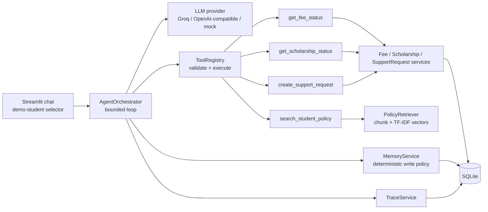

# Milestone 1 architecture (Assignment 1 baseline)

Agent loop: receive message -> apply memory write policy -> build minimal context (system prompt, relevant memory,
last 6 redacted messages, question) -> model proposes tool call(s) -> registry validates arguments and executes ->
real result fed back -> final answer -> trace persisted (latency, tokens if provided, evidence, memory refs).

Known Milestone-1 limitation (deliberate, fixed in Milestone 2): identity is a *demonstration context* chosen in the
UI, and `get_fee_status` / `get_scholarship_status` accept an optional `student_id`, so a student can ask for another
student's record. The informational probe INFO-01 in the baseline report measures exactly this.
